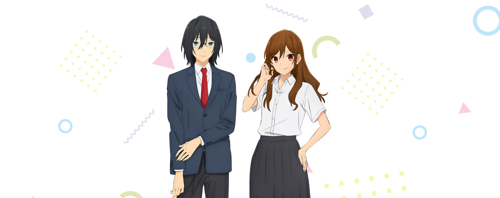
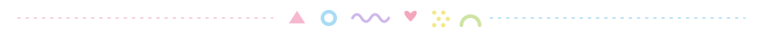
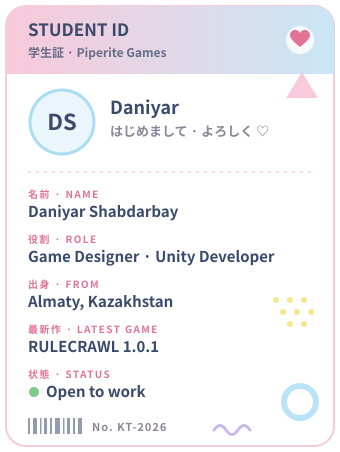

  

<h1 align="center">Hi 👋, I'm Daniyar</h1>

<h3 align="center">Game Designer &amp; Unity Developer</h3>

  

  <i>Everyone has a side they don't show at school. Mine makes games.</i>

<h2 align="center">🌸 About Me 自己紹介</h2>

**Daniyar** here: a game designer and Unity developer from Almaty who cares about how games *feel* and the systems that make them work.

I build gameplay in **Unity 6** and **C#**: combat, procedural rooms, saves, audio and localization. My pixel-art roguelite **[RULECRAWL](https://kyomutenshi.itch.io/rulecrawl)** is out now: play it in the browser, on your phone or with a gamepad.

My background is Information Systems (Game Development) at **AlmaU** with a Product Design minor, and on the side I write **Java** for the backend.

I've worked on team projects and in lead roles across design and development. Right now I'm open to **Game Designer** and **Unity Developer** roles, as well as freelance work.

 

<h2 align="center">🤝 Connect つながり</h2>

  <a href="https://github.com/KyomuTenshi"><picture><source media="(prefers-color-scheme: dark)" srcset="https://skillicons.dev/icons?i=github&theme=dark" /></picture></a>&nbsp;
  <a href="https://www.linkedin.com/in/daniyarshabdarbay"><picture><source media="(prefers-color-scheme: dark)" srcset="https://skillicons.dev/icons?i=linkedin&theme=dark" /></picture></a>&nbsp;
  <a href="mailto:daniyar.gamedev@gmail.com"><picture><source media="(prefers-color-scheme: dark)" srcset="https://skillicons.dev/icons?i=gmail&theme=dark" /></picture></a>&nbsp;
  <a href="https://kyomutenshi.itch.io"><picture><source media="(prefers-color-scheme: dark)" srcset="assets/itch-dark.svg" /></picture></a>

<h2 align="center">🛠 Tech Stack 技術</h2>

  <picture>
    <source media="(prefers-color-scheme: dark)" srcset="https://skillicons.dev/icons?i=unity%2Ccs%2Cblender%2Cfigma%2Cps%2Cai%2Cgit%2Cgithub%2Capple&perline=9&theme=dark" />
    
  </picture>
   
  <picture>
    <source media="(prefers-color-scheme: dark)" srcset="https://skillicons.dev/icons?i=java%2Cgradle%2Cidea%2Cpython%2Cflutter%2Cdart%2Chtml%2Ccss%2Cjs&perline=9&theme=dark" />
    
  </picture>

  <b>Learning now:</b> Spring · PostgreSQL · Docker · Django

<h2 align="center">🚪 Featured: RULECRAWL 最新作</h2>

  

  Pixel-art roguelite where every door rewrites the rules: mechanics, light and music. 
  15 laws · 4 heroes · 4 modes · 84 relics · 3 endings · Unity 6 URP 2D · C#

  
  

<b>What's inside</b>

 

- 15 laws, each with its own mechanic, post-processing, light and music
- 4 heroes and 4 modes: Run, Daily (one seed for everyone), Chaos and Endless
- 84 relics and 42 relic combos, curses, active items, a shop, an altar, a fountain and a gacha terminal
- Procedural floors rebuilt every run, plus portal worlds with their own bosses and music
- An isekai story about Adam and his sister Amelia: three corrupted saves, in-engine cutscenes and three endings
- Touch controls in the phone browser, gamepad prompts for Xbox, PlayStation and Switch, rebindable controls
- 4 languages: English, Russian, Chinese and Spanish
- **Stack:** Unity 6 (URP 2D), C#, Input System · **Platforms:** Web (desktop and mobile), Windows, macOS

<h2 align="center">🗂 Other Projects 作品</h2>

  <a href="https://github.com/KyomuTenshi/Ancestra-DevBuild"><picture><source media="(prefers-color-scheme: dark)" srcset="https://raw.githubusercontent.com/KyomuTenshi/KyomuTenshi/output/pin-ancestra-dark.svg" /></picture></a>
  <a href="https://github.com/KyomuTenshi/Souls-Like-Prototype"><picture><source media="(prefers-color-scheme: dark)" srcset="https://raw.githubusercontent.com/KyomuTenshi/KyomuTenshi/output/pin-souls-like-dark.svg" /></picture></a>
  <a href="https://github.com/KyomuTenshi/Transaction-Analyzer"><picture><source media="(prefers-color-scheme: dark)" srcset="https://raw.githubusercontent.com/KyomuTenshi/KyomuTenshi/output/pin-transaction-analyzer-dark.svg" /></picture></a>
  <a href="https://github.com/KyomuTenshi/Nexora-DevBuild"><picture><source media="(prefers-color-scheme: dark)" srcset="https://raw.githubusercontent.com/KyomuTenshi/KyomuTenshi/output/pin-nexora-dark.svg" /></picture></a>

<h2 align="center">📊 GitHub Stats 統計</h2>

  <picture><source media="(prefers-color-scheme: dark)" srcset="https://raw.githubusercontent.com/KyomuTenshi/KyomuTenshi/output/stats-dark.svg" /></picture>
  <picture><source media="(prefers-color-scheme: dark)" srcset="https://raw.githubusercontent.com/KyomuTenshi/KyomuTenshi/output/streak-dark.svg" /></picture>

  <picture><source media="(prefers-color-scheme: dark)" srcset="https://raw.githubusercontent.com/KyomuTenshi/KyomuTenshi/output/top-langs-dark.svg" /></picture>

<h2 align="center">🐍 Activity 活動</h2>

  <picture>
    <source media="(prefers-color-scheme: dark)" srcset="https://raw.githubusercontent.com/KyomuTenshi/KyomuTenshi/output/snake-dark.svg" />
    
  </picture>

<h2 align="center">🗺 Journey 歩み</h2>

| Year | |
|:--|:--|
| 2020–2022 | 🖌 Graphic design courses at **IT STEP Academy** |
| 2023–2026 | 🎓 **AlmaU**: BSc Information Systems, Game Development, Product Design minor |
| 2025 | 🕹 **Punkverse Game Jam SU 2025**: first prototype of ANCESTRA |
| 2026 | 🏚 Diploma project **ANCESTRA** |
| 2026 | ☕ Advanced Java Core (Skillbox): **Transaction Analyzer** |
| 2026 | 🚪 **RULECRAWL** released on [itch.io](https://kyomutenshi.itch.io/rulecrawl), update 1.0.1 adds phones and gamepads |
| Now | 🔦 Unity games, Java backend, freelance |

  

