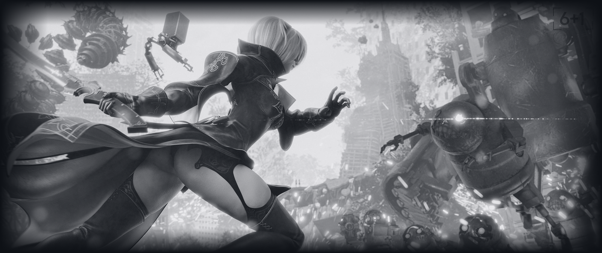

<p align="center">
  
</p>

<h1 align="center">Hi there, I'm Daniyar Shabdarbay 👋</h1>
<h3 align="center">Game Designer & Unity Developer · C# · Unity · Blender</h3>

<p align="center">
  <sub><code>LEVEL 0 — "ALMOST EMPTY" · you noclipped out of reality</code></sub>
</p>

<p align="center">
  
</p>

<p align="center">
  <sub>🟡 fluorescent lights humming · yellow walls · damp carpet smell · <code>entities_detected: 0</code></sub>
</p>

<p align="center">
  <a href="https://www.linkedin.com/in/daniyarshabdarbay">
    
  </a>
  <a href="mailto:daniyar.gamedev@gmail.com">
    
  </a>
</p>

<br>

## 🧑‍💻 About Me

<sub><code>WANDERER LOG #001 · LEVEL 1 — "HABITABLE ZONE"</code></sub>

```python
class Developer:
    def __init__(self):
        self.name = "Daniyar Shabdarbay"
        self.location = "Almaty, Kazakhstan"
        self.role = ["Game Designer", "Unity Developer"]
        self.education = "BSc Information Systems (Game Development), AlmaU, 2026"
        self.main_stack = ["Unity", "C#", "Blender"]
        self.design = ["Figma", "Photoshop", "Illustrator"]
        self.currently_learning = ["Java", "Spring", "Docker"]
        self.always_learning = True
```

I'm a game designer and Unity developer from Almaty. In 2026 I graduated from **AlmaU** with a Bachelor's degree in **Information Systems**, specializing in **Game Development**, with a **Product Design** minor.

I enjoy both sides of making games: designing how a game should feel, and building the systems that make it work.

- 🎮 Designing games and gameplay mechanics, and prototyping them in **Unity**
- 💻 Programming game systems in **C#**: events, saving, localization, audio, player controllers
- 🧊 Working with 3D in **Blender**
- 🎨 UI and graphic design in **Figma**, **Photoshop** and **Illustrator**
- 👥 Team projects as a developer, designer and game designer, sometimes as team lead
- ☕ Currently learning **Java backend development**

<p align="center">
  
</p>

<br>

## 🕯 Featured Projects

<sub><code>LEVEL 2 — "THE HUB" · every level connects back here</code></sub>

### 🏚 [Ancestra](https://github.com/KyomuTenshi/Ancestra-DevBuild) — diploma project
First-person psychological horror / walking simulator about grief, guilt and memory. The player returns to a family home that keeps changing and uncovers an unfinished testament.

- Prototype made at **Punkverse Game Jam SU 2025**, then developed solo as my diploma project
- Structure: a prologue and five zones based on the five stages of grief, each zone adds one new mechanic
- Systems in C#: type-safe event bus, save system with atomic writes, checksums and version migration, localization with plural forms, audio with crossfades and SFX pooling, first-person controller with a fear system
- **Stack:** Unity 2022.3 LTS (URP), C#, Input System, TextMeshPro
- **Status:** MVP in development
- <sub>3D models: pizzadoggy asset pack. Music is not my own.</sub>

<!-- Uncomment after making the repository public
### ⚔️ [Souls-Like Prototype](https://github.com/KyomuTenshi/Souls-Like-Prototype)
A personal prototype inspired by Souls-like games, built to practice designing and programming gameplay mechanics and game systems.
- **Stack:** Unity, C#
-->

### 📱 [Nexora](https://github.com/KyomuTenshi/Nexora-DevBuild)
A cross-platform mobile app for watching anime and reading manga. UI designed in Figma, built with Flutter and Dart.

### ☕ [Transaction Analyzer](https://github.com/KyomuTenshi/Transaction-Analyzer)
A console Java application for practicing Java Core: data processing with Streams and generics, OOP and layered architecture.

<p align="center">
  
</p>

<br>

## 🛠 Tech Stack

<sub><code>LEVEL 3 — "PIPE DREAMS" · inventory checkpoint</code></sub>

**Main**

<p align="center">
  
  
  
  
</p>

**Design**

<p align="center">
  
  
  
</p>

**Also worked with**

<p align="center">
  
  
  
  
  
  
  
</p>

**Currently learning**

<p align="center">
  
  
  
  
</p>

<p align="center">
  
</p>

<br>

## 🗺 Path So Far

<sub><code>LEVEL 4 — "THE OFFICES" · save points found</code></sub>

| Year | Save point |
|:--|:--|
| 2020–2022 | 🖌 Graphic design courses at **IT STEP Academy** |
| 2023–2026 | 🎓 **AlmaU**: BSc in Information Systems, Game Development specialization, Product Design minor |
| 2025 | 🕹 **Punkverse Game Jam SU 2025** (Satbayev University): first prototype of Ancestra |
| 2026 | 🏚 Diploma project: **Ancestra** |
| Now | 🔦 Developing games in Unity, learning Java backend, taking freelance work |

<p align="center">
  
</p>

<br>

## 🔭 Current Focus

<sub><code>LEVEL 5 — "RUN FOR YOUR LIFE" · active objectives</code></sub>

- 🏚 Bringing Ancestra from MVP to a playable build
- 🎮 Looking for a role as a **Game Designer** or **Unity Developer**
- ☕ Learning Java backend: Spring, PostgreSQL, Docker

<p align="center">
  
</p>

<br>

## 📫 Connect With Me

<sub><code>LEVEL ! — "FOUND" · a way back to reality (allegedly)</code></sub>

<p align="center">
  <a href="https://www.linkedin.com/in/daniyarshabdarbay">
    
  </a>
  <a href="mailto:daniyar.gamedev@gmail.com">
    
  </a>
  <a href="https://github.com/KyomuTenshi">
    
  </a>
</p>

<br>

<p align="center">
  
</p>

<p align="center">
  <sub><code>LOOP: TRUE — NO-CLIP FAILED — SEE YOU IN LEVEL 0</code></sub>
</p>
